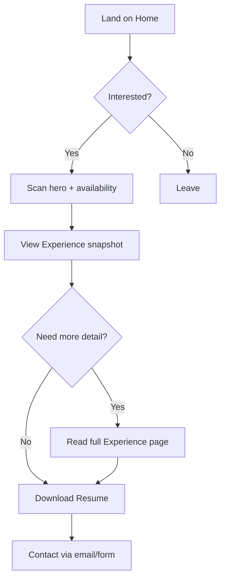
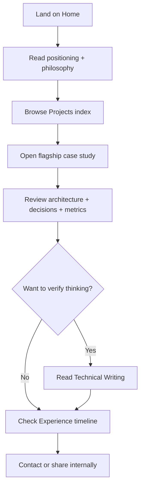
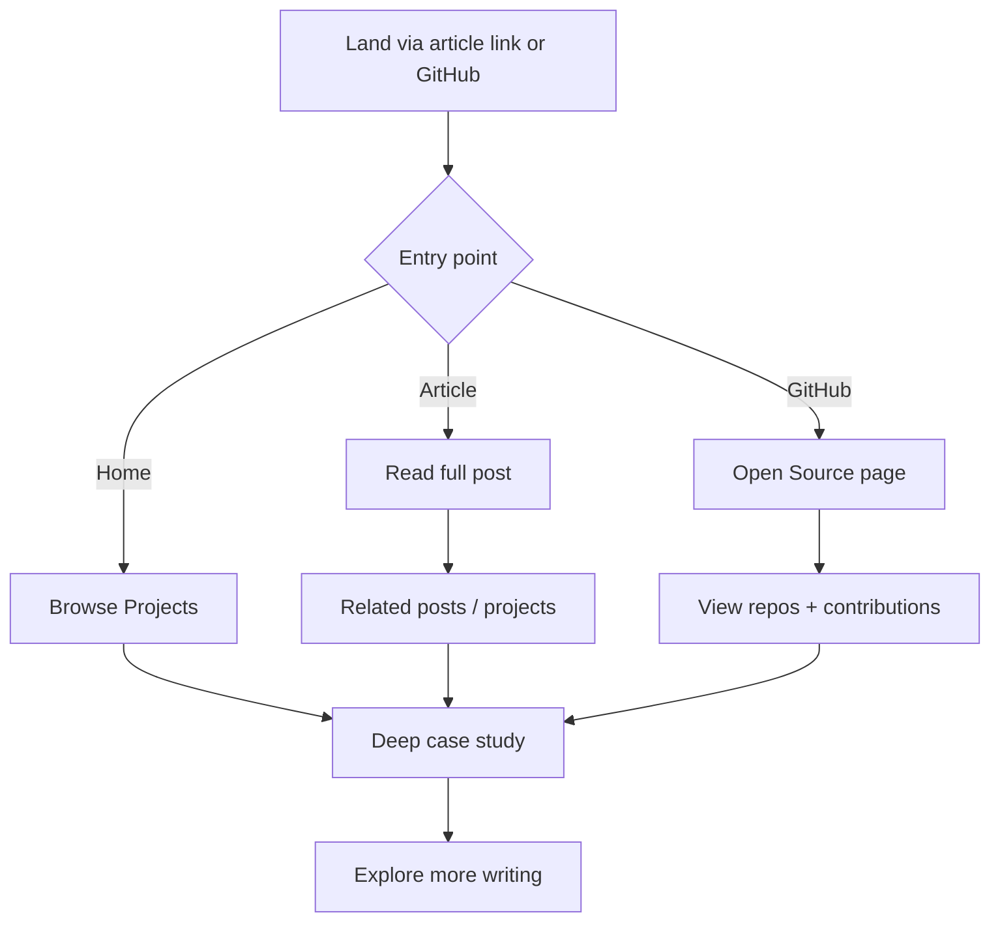
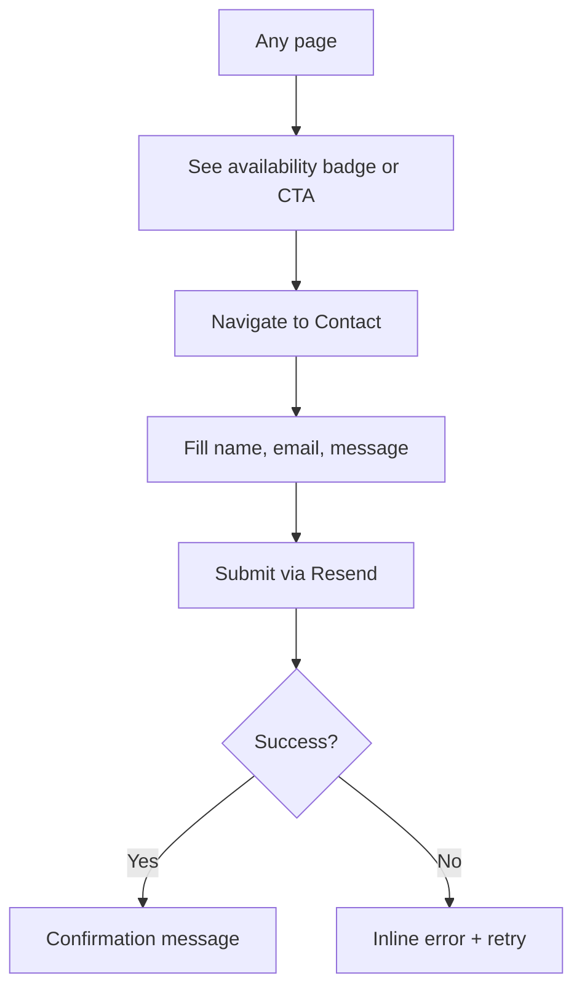

# User Flows

Three primary visitor personas drive the information architecture and page priority.

## Personas

### 1. Recruiter / Hiring Manager

**Goal:** Quickly assess fit for a senior backend role.

**Time budget:** 2–5 minutes.

**Success:** Downloads resume or sends contact message.

### 2. Engineering Leader (CTO, VP Eng, Staff+)

**Goal:** Evaluate engineering depth, system design thinking, and production experience.

**Time budget:** 5–15 minutes.

**Success:** Reads a project case study and checks technical writing.

### 3. Fellow Engineer

**Goal:** Explore how problems were solved, learn from architecture decisions.

**Time budget:** 10+ minutes.

**Success:** Reads case studies and articles, explores open source.

---

## Flow 1: Recruiter Quick Scan

**Key pages:** Home → Experience → Resume → Contact

**Design priority:** Hero clarity, availability badge, resume download prominent, contact frictionless.

---

## Flow 2: Engineering Leader Deep Dive

**Key pages:** Home → Projects → Case Study → Writing → Experience

**Design priority:** Case study depth, architecture diagrams, measurable impact, trade-off narratives.

---

## Flow 3: Fellow Engineer Exploration

**Key pages:** Writing, Projects, Open Source

**Design priority:** Code samples, syntax highlighting, architecture diagrams, related content links.

---

## Flow 4: Contact Conversion

**Fallback:** Direct `mailto:` link always visible in footer.

---

## Global Navigation Patterns

| Pattern | Behavior |
| --- | --- |
| Header | Sticky on scroll, backdrop blur, compact on mobile |
| Mobile menu | Full-screen overlay with focus trap |
| Footer | Persistent social links + legal |
| Breadcrumbs | Project and writing detail pages only |
| Skip link | "Skip to content" — first focusable element |
| 404 | Helpful links back to Home, Projects, Contact |

## Keyboard & Command Patterns (Phase 4)

Deferred to Phase 4 but planned now:

| Shortcut | Action |
| --- | --- |
| `⌘/Ctrl + K` | Open command palette |
| `G then H` | Go home |
| `G then P` | Go to projects |
| `G then W` | Go to writing |
| `G then C` | Go to contact |
| `?` | Show keyboard shortcuts |

## Empty States

Every content section needs an empty state for Phase 3 launch before content is added:

| Section | Empty state message |
| --- | --- |
| Projects | "Case studies coming soon." |
| Writing | "Articles in progress." |
| Open Source | "GitHub integration coming in Phase 4." |
| Latest on Home | Link to full section with empty state |
