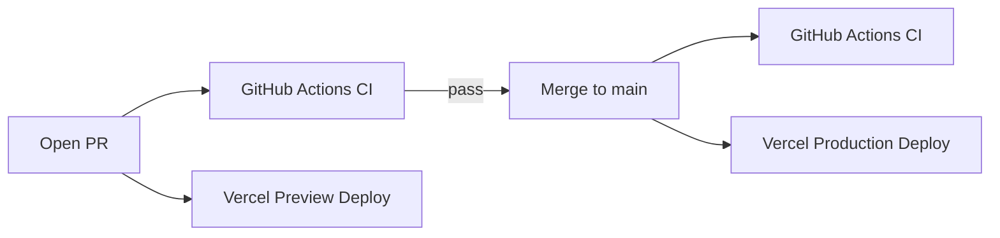

# CI/CD Setup (Post-Vercel Deploy)

Your pipeline has two parts that work together:

| System | Role |
| --- | --- |
| **Vercel** | Builds and deploys the site (production + previews) |
| **GitHub Actions** | Validates code before merge (lint, tests, build, E2E) |

You do **not** need a separate deploy workflow — Vercel's Git integration handles deployment.

---

## How it works



1. **Pull request** → CI runs + Vercel creates a preview URL
2. **Merge to `main`** → CI runs again + Vercel deploys to production
3. **Branch protection** (recommended) → blocks merge until CI passes

---

## Step 1 — Confirm GitHub Actions is running

1. Open [github.com/Shakeelkhan8/portfolio/actions](https://github.com/Shakeelkhan8/portfolio/actions)
2. You should see the **CI** workflow
3. Latest run on `main` should show two jobs:
   - **Lint, typecheck, test, build**
   - **Playwright smoke tests**

If no runs appear:

- Go to **Settings → Actions → General**
- Set **Actions permissions** to **Allow all actions**
- Push a small commit or use **Actions → CI → Run workflow**

---

## Step 2 — Protect `main` (required for smooth CI/CD)

This stops broken code from reaching production.

1. Repo → **Settings → Branches → Add branch ruleset** (or classic rule)
2. Target branch: `main`
3. Enable:
   - **Require a pull request before merging**
   - **Require status checks to pass**
4. Add these required checks (exact names from the workflow):

   | Check name |
   | --- |
   | `Lint, typecheck, test, build` |
   | `Playwright smoke tests` |

5. Enable **Require branches to be up to date before merging**
6. Save

> After the first CI run completes, check names appear in the dropdown. If they don't show yet, merge one PR first so Actions runs at least once.

---

## Step 3 — Vercel Git settings

In [vercel.com](https://vercel.com) → your project → **Settings → Git**:

| Setting | Value |
| --- | --- |
| **Production Branch** | `main` |
| **Preview Deployments** | Enabled |
| **Auto-deploy** | Enabled |

**Settings → General → Build & Development:**

| Setting | Value |
| --- | --- |
| Framework | Next.js |
| Install Command | `pnpm install --frozen-lockfile` |
| Build Command | `pnpm build` |
| Node.js Version | 20.x |

These match `vercel.json` — Vercel should pick them up automatically.

---

## Step 4 — Environment variables on Vercel

**Settings → Environment Variables**

### Production (required)

| Variable | Example |
| --- | --- |
| `NEXT_PUBLIC_SITE_URL` | `https://your-project.vercel.app` or custom domain |

### Production (recommended)

| Variable | Value |
| --- | --- |
| `RESEND_API_KEY` | From Resend dashboard |
| `CONTACT_EMAIL` | `shakeelkhan4147@gmail.com` |
| `GITHUB_TOKEN` | GitHub PAT (optional, for `/open-source` rate limits) |

Apply **Preview** env vars too — at minimum set `NEXT_PUBLIC_SITE_URL` to the Vercel preview URL pattern or leave unset (previews still work, metadata may use localhost fallback).

After changing env vars → **Deployments → Redeploy** (env changes don't apply to past deploys).

---

## Step 5 — Verify the full loop

### On a PR

1. Create a branch: `git checkout -b test/ci-check`
2. Make a trivial change, push, open PR
3. Confirm:
   - [ ] GitHub Actions CI — both jobs green
   - [ ] Vercel bot comment with preview URL (if not silent)
   - [ ] Preview site loads

### On merge to `main`

1. Merge the PR
2. Confirm:
   - [ ] CI passes on `main`
   - [ ] Vercel production deployment succeeds
   - [ ] Live site matches latest code

### Smoke test production

- [ ] `/` homepage
- [ ] `/projects`, `/contact`
- [ ] `/sitemap.xml`, `/robots.txt`
- [ ] Contact form (if Resend configured)

---

## Step 6 — Optional hardening

### Vercel deployment protection

**Settings → Deployment Protection** (Pro/Team):

- Enable protection on production
- Require approval before promoting (optional)

### Sentry + Plausible (when ready)

Add to Vercel env vars — see `docs/phase-6/README.md`.

### Manual CI trigger

**Actions → CI → Run workflow** — useful after changing workflow files.

---

## Troubleshooting

| Problem | Fix |
| --- | --- |
| CI fails on `pnpm install` | Ensure `pnpm-lock.yaml` is committed; run `pnpm install` locally and push lockfile |
| Playwright fails in CI only | Download artifact from failed run; check `test-results/` |
| Vercel build fails, CI passes | Check Vercel env vars; Sentry needs `SENTRY_*` only if configured |
| `NEXT_PUBLIC_SITE_URL` wrong OG/sitemap | Update in Vercel → Redeploy |
| Branch protection blocks merge | Wait for both CI jobs; re-run failed workflow if flaky |
| No GitHub Actions runs | Enable Actions in repo settings; confirm `.github/workflows/ci.yml` is on `main` |

---

## Local commands (match CI)

```bash
pnpm typecheck
pnpm lint
pnpm test
pnpm build
pnpm test:e2e
```

---

## What you don't need

- Separate `deploy.yml` — Vercel deploys via Git
- `VERCEL_TOKEN` in GitHub — only for CLI-based deploys
- Duplicate build in CI and Vercel — CI validates; Vercel deploys (intentional overlap)
